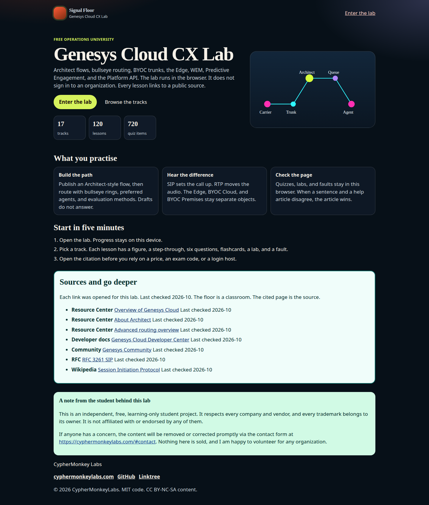
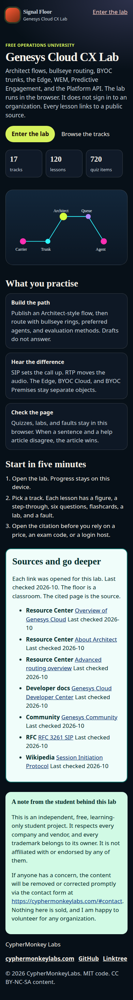
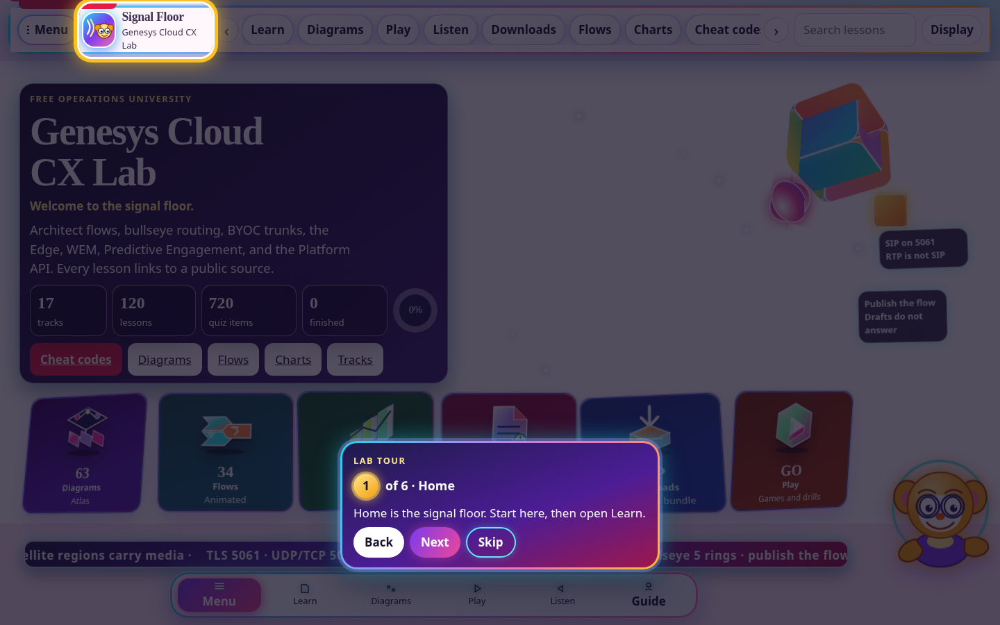
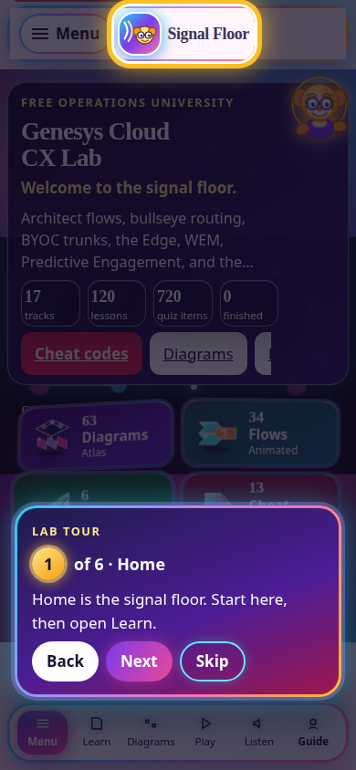
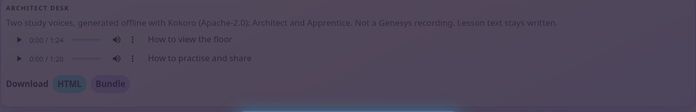
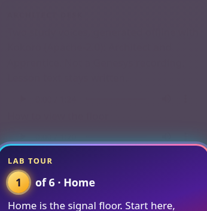

# Genesys Cloud CX Lab

Signal Floor is a free, static operations university for Genesys Cloud CX. It runs in the browser, stores progress locally, and does not call a live organization.

The curriculum covers organization setup, Architect flows, ACD routing, queues and skills, a skills-and-ACD chapter (evaluation, bullseye expansion, skill expression filters, and direct routing), BYOC Cloud and Premises, SIP trunks, the Edge, emergency calling, workforce management, a forecasting chapter (views, creation methods, the editor, and schedule coverage), quality management, speech and text analytics, a quality-and-speech chapter (forms, AI scoring, programs, and limits), Genesys AI and bots, Predictive Engagement, Platform APIs, AppFoundry and CRM embeds, and migration from Genesys Engage, PureConnect, and Cisco UCCE / UCCX. The ecosystem page holds the glossary, mind map, sister technologies, integration map, and the CRM, BYOC, and AI-agent bridges. CUCM and Webex appear as a learning bridge with Cisco citations, not as a converter.

## Run it

From the repository root:

```bash
python3 scripts/build_curriculum.py
python3 scripts/build_downloads.py
python3 -m http.server 8741
```

Open [http://127.0.0.1:8741/](http://127.0.0.1:8741/) for the landing page, then [http://127.0.0.1:8741/campus/](http://127.0.0.1:8741/campus/) for the lab. The published canonical URLs are absolute: `https://cyphermonkeylabs.com/genesys-cloud-lab-free-university-mesmerizing/` and `.../campus/`.

Check the curriculum without a browser:

```bash
node scripts/verify.mjs
```

`verify.mjs` counts tracks, lessons, quiz items, labs, and faults, checks that every citation is an `https` URL on an allowed documentation host, measures the first-load shell, and asserts the teaching router: preferred agents beat a longer-idle peer, all-skills matching picks the longest idle full match, bullseye drops a skill after the ring delay, a priority of 5 beats a priority of 0 that arrived four minutes earlier, and utilized or off-queue agents are skipped.

## What you can do

- Read a lesson with a figure, a Play / Pause / Step / Inspect flow, a six-question quiz, flashcards, a lab checklist, and a fault with a synthetic log.
- Build an Architect-style task list and export learning JSON marked not importable.
- Simulate routing with conversation score, bullseye rings, preferred agents, and evaluation methods.
- Browse Platform API samples, including the client-credentials limit on `/api/v2/users/me`. Nothing is sent.
- Classify a dial string against the documented default number plans.
- Map Engage, PureConnect, and Cisco objects to the Genesys objects you rebuild.
- Orbit a 3D floor (vendored Three.js r186) or the flat map, and toggle trunk, Edge, queue, bot, and CRM failures.
- Work boss incidents, an interview drill, a glossary, and the certification catalog as read on 14 October 2026. Predictive Engagement and the 2026 deprecation notes were read on 15 October 2026.
- Switch among futuristic, gaming, neon, light, night, paper, harbor, and high-contrast themes. Sound, narration, voice, speed, reduced motion, and type size persist in `localStorage`. Narration waits for `voiceschanged` and will not select Microsoft David, Zira, or Mark.
- Open the diagram atlas, the port table, the port game, the flow map, the call-flow sandbox, the daily challenge, and badges. Progress stays in this browser.
- Download one-page cheat sheets (HTML, PDF, PNG, SVG), a flashcard deck, or the offline zip from Cheat codes. Each file links back to the public source instead of pasting the vendor document.

Track JSON loads when you open a track. Three.js loads when you open the topology. Settings can cache tracks for offline use. The service worker does not prefetch every track at install, so the first view stays small.

## Counts

Verified by `node scripts/verify.mjs` on 16 October 2026:

| | |
| --- | ---: |
| Tracks | 20 |
| Lessons | 142 |
| Quiz items | 852 |
| Labs | 142 |
| Faults | 142 |
| Glossary entries | 55 |
| Boss incidents | 8 |
| Interview questions | 26 |
| Diagrams in the atlas | 63 |
| Animated flows | 34 |
| Charts | 6 |
| Mermaid SVGs (build time) | 6 |
| Cheat sheets | 13 |
| Flashcards in the download deck | 568 |
| Studios | 5 |
| First-load shell | 149,966 bytes |

The shell is `campus/index.html`, `campus/assets/app.js`, `campus/data/manifest.json`, and the web manifest. Studios, charts, Markmap, topology, Three.js, track JSON, and `reference.json` stay off that first paint. Three.js loads with the hero wireframe and the topology view. Mermaid is not shipped to the browser; `scripts/build_mermaid.mjs` writes the SVGs.

Lighthouse mobile against `http://127.0.0.1:8741/campus/` on 16 October 2026, gzip server, Lighthouse 12 default mobile emulation, was recorded before the chapter expansion: performance 98, accessibility 100, best-practices 100, SEO 100, total blocking time 0 ms, largest contentful paint about 2.1 s. Cumulative layout shift on that run is 0.046, on the home hero. The icon row reserves its phone height so filling the counters does not grow the page. This chapter pass checked the landing page, the menu, a skills lesson, and the ecosystem map at 390×844 and 1440×900. It did not repeat Lighthouse.

## Citations

Lessons link to the Genesys Cloud Resource Center, the Developer Center, Genesys Education, AppFoundry, Cisco’s UCCE and UCCX series pages, and the SIP, RTP, SRTP, DTMF, and documentation-address RFCs. Specialist exams are named from the catalog. This lab does not assign GCX- codes, copy fair-use prices, paste Dynamic Cloud Voice prefixes, or state a PureConnect end date. When a live page and a lesson disagree, the page wins. Uncertain sentences are marked in the lesson.

Synthetic logs use the documentation ranges in RFC 5737 and fictional 555 numbers.

## Screenshots














## License

Code is MIT. Educational prose is CC BY-NC-SA 4.0. See [LICENSE](LICENSE). Three.js remains under the license in `campus/vendor/THREE-LICENSE.txt`.

## Gaps left on purpose

- The contact form at `https://cyphermonkeylabs.com/#contact` returned HTTP 500 when this lab last checked it. The link is the removal path. Whether the form works now is unverified.
- Lesson narration still uses the browser's own voice. The two desk clips in `audio/` are Kokoro (Apache-2.0), not a recording of a person.
- Diagram PNG downloads are bitmap title cards from the build script, not full illustrations of the live SVG figures. PPTX and DOCX are minimal Office Open XML. They were not opened in PowerPoint or Word here.
- A Chrome extension, Capacitor iOS/Android projects, and an embed widget script are described in `docs/PUBLISHING.md` as prepared, not built. The PWA (manifest and service worker) is built.
- There is no business-requirements pack. The downloadable template is a lab checklist.
- Flashcards PDF is multipage text. It is not a designed card layout.
- This lab did not sign in to an organization. Journey Outcomes list a planned effective date of 2026-06-29. Customer Outcomes and the Predictive Routing custom-KPI framework were still described as upcoming on the pages read 15 October 2026. If those pages move, the pages win. No named customer story is included.
- The use case names action-map performance for web chat, content offers, and Architect flow. A web-messaging column was not confirmed on the live report.
- WebRTC firewall rows stay on the parent ports article. This lab’s table is only the rows it opened.
- No named customer story is included. Salesforce and Zendesk are the documented embeds. Other CRMs stay on AppFoundry.
- The labs site contact link is `https://cyphermonkeylabs.com/#contact`. That site returned HTTP 500 when it was fetched during this build, so the form anchor is unverified.
- The footer sibling strip uses `https://cyphermonkeylabs.com/<repo>/`. The earlier GitHub Pages copies of those eight pages returned HTTP 200 on 15 October 2026. Origin `main` for this repo was readable and is the earlier lab, not a richer copy, so it was not merged over this branch.
- The first screen reserves a full-bleed call-path stage. Desktop loads the three.js globe after idle, with bloom deferred again. Mobile shows the labelled drawing until “Play the 3D floor”, then runs the globe at a pixel ratio of 1 and without bloom. Track-card meshes stay on the isometric drawing on small screens. A scripted Guide Bot answers from `campus/data/guide-kb.json` and will not invent a fact that is not in those notes. Lesson prose stays English; track and lesson headings follow the language switcher. The audio player is wired to audio/tour.mp3 and audio/practice.mp3. Those clips are Kokoro voices am_michael and af_heart. Rebuild them with `python3 scripts/build_audio.py`.
