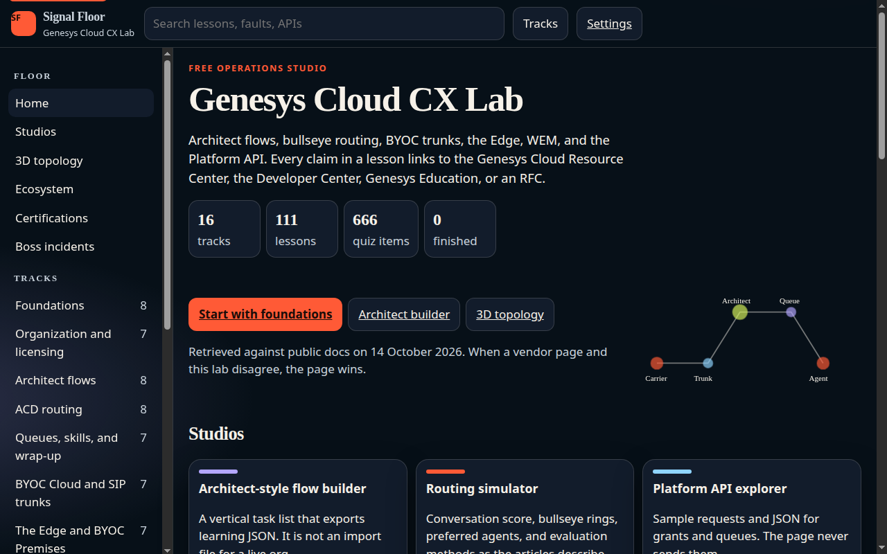
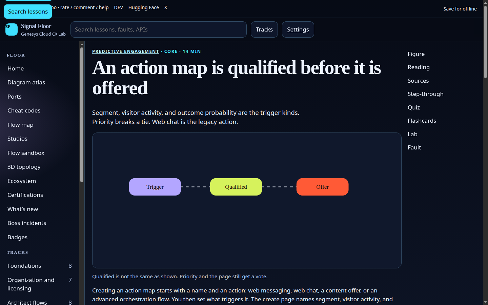
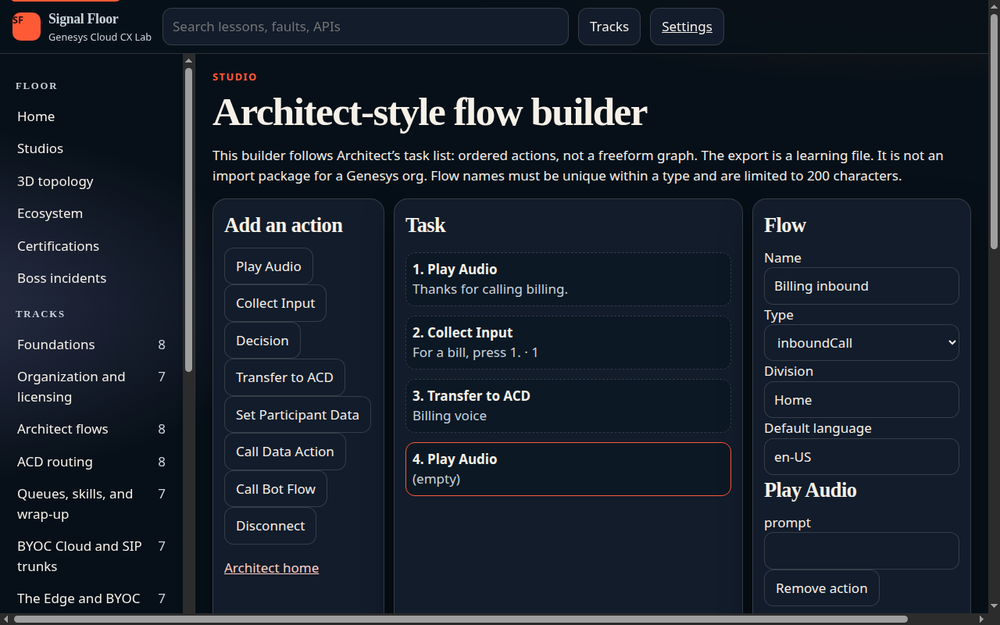
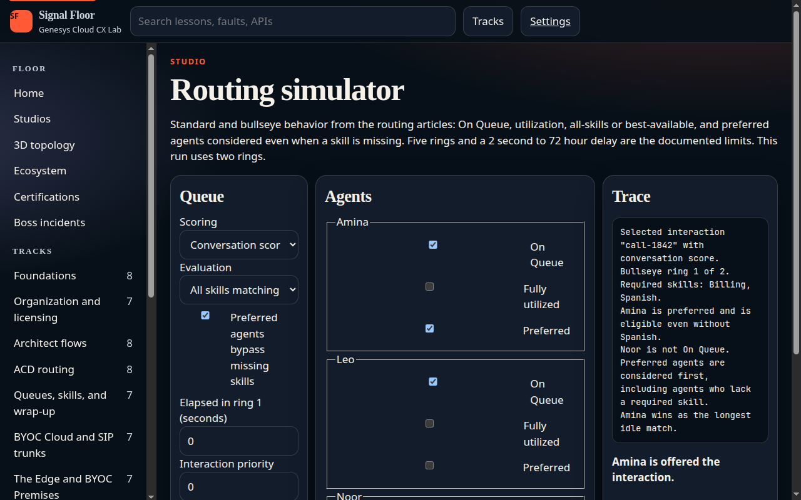
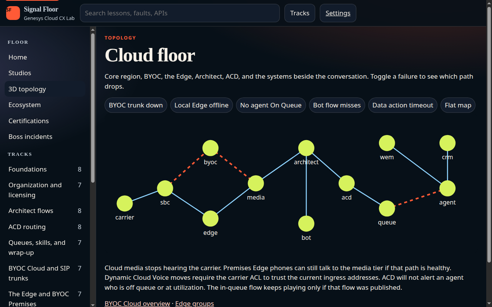
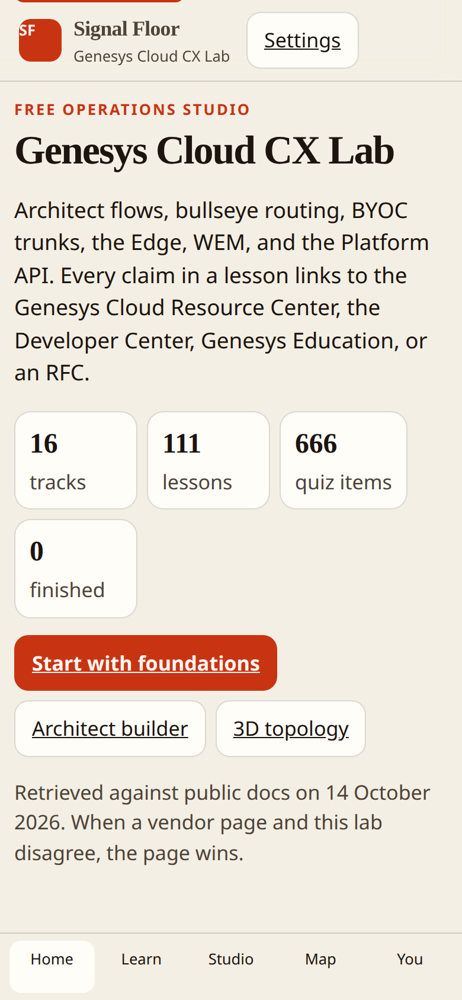

# Genesys Cloud CX Lab

Signal Floor is a free, static operations university for Genesys Cloud CX. It runs in the browser, stores progress locally, and does not call a live organization.

The curriculum covers organization setup, Architect flows, ACD routing, queues and skills, BYOC Cloud and Premises, SIP trunks, the Edge, emergency calling, workforce management (including forecasts and schedule generation), quality management, speech and text analytics, Genesys AI and bots, Predictive Engagement, Platform APIs, AppFoundry and CRM embeds, and migration from Genesys Engage, PureConnect, and Cisco UCCE / UCCX. CUCM and Webex appear as a learning bridge with Cisco citations, not as a converter.

## Run it

From the repository root:

```bash
python3 scripts/build_curriculum.py
python3 scripts/build_downloads.py
python3 -m http.server 8741
```

Open [http://127.0.0.1:8741/campus/](http://127.0.0.1:8741/campus/). The root page only redirects into `campus/`, which is the GitHub Pages folder.

Check the curriculum without a browser:

```bash
node scripts/verify.mjs
```

`verify.mjs` counts tracks, lessons, quiz items, labs, and faults, checks that every citation is an `https` URL on an allowed documentation host, measures the first-load shell, and asserts the teaching router: preferred agents beat a longer-idle peer, all-skills matching picks the longest idle full match, bullseye drops a skill after the ring delay, a priority of 5 beats a priority of 0 that arrived four minutes earlier, and utilized or off-queue agents are skipped.

## What you can do

- Read a lesson with a figure, a Play / Pause / Step / Inspect flow, a six-question quiz, flashcards, a lab checklist, and a fault with a synthetic log.
- Build an Architect-style task list and export learning JSON marked not importable.
- Simulate routing with conversation score, bullseye rings, preferred agents, and evaluation methods.
- Browse Platform API samples, including the client-credentials limit on `/api/v2/users/me`. Nothing is sent.
- Classify a dial string against the documented default number plans.
- Map Engage, PureConnect, and Cisco objects to the Genesys objects you rebuild.
- Orbit a 3D floor (vendored Three.js r186) or the flat map, and toggle trunk, Edge, queue, bot, and CRM failures.
- Work boss incidents, an interview drill, a glossary, and the certification catalog as read on 14 October 2026. Predictive Engagement and the 2026 deprecation notes were read on 15 October 2026.
- Switch among futuristic, gaming, neon, light, night, paper, harbor, and high-contrast themes. Sound, narration, voice, speed, reduced motion, and type size persist in `localStorage`. Narration waits for `voiceschanged` and will not select Microsoft David, Zira, or Mark.
- Open the diagram atlas, the port table, the port game, the flow map, the call-flow sandbox, the daily challenge, and badges. Progress stays in this browser.
- Download one-page cheat sheets (HTML, PDF, PNG, SVG), a flashcard deck, or the offline zip from Cheat codes. Each file links back to the public source instead of pasting the vendor document.

Track JSON loads when you open a track. Three.js loads when you open the topology. Settings can cache tracks for offline use. The service worker does not prefetch every track at install, so the first view stays small.

## Counts

Verified by `node scripts/verify.mjs` on 15 October 2026:

| | |
| --- | ---: |
| Tracks | 17 |
| Lessons | 120 |
| Quiz items | 720 |
| Labs | 120 |
| Faults | 120 |
| Glossary entries | 50 |
| Boss incidents | 8 |
| Interview questions | 26 |
| Diagrams in the atlas | 47 |
| Animated flows | 26 |
| Charts | 6 |
| Mermaid SVGs (build time) | 6 |
| Cheat sheets | 13 |
| Flashcards in the download deck | 480 |
| Studios | 5 |
| First-load shell | 105,011 bytes |

The shell is `campus/index.html`, `campus/assets/app.js`, `campus/data/manifest.json`, and the web manifest. Studios, charts, Markmap, topology, Three.js, track JSON, and `reference.json` stay off that first paint. Three.js loads with the hero wireframe and the topology view. Mermaid is not shipped to the browser; `scripts/build_mermaid.mjs` writes the SVGs.

Lighthouse mobile, captured against `http://127.0.0.1:8741/campus/` on 14 October 2026: performance 100, accessibility 100.

## Citations

Lessons link to the Genesys Cloud Resource Center, the Developer Center, Genesys Education, AppFoundry, Cisco’s UCCE and UCCX series pages, and the SIP, RTP, SRTP, DTMF, and documentation-address RFCs. Specialist exams are named from the catalog. This lab does not assign GCX- codes, copy fair-use prices, paste Dynamic Cloud Voice prefixes, or state a PureConnect end date. When a live page and a lesson disagree, the page wins. Uncertain sentences are marked in the lesson.

Synthetic logs use the documentation ranges in RFC 5737 and fictional 555 numbers.

## Screenshots













## License

Code is MIT. Educational prose is CC BY-NC-SA 4.0. See [LICENSE](LICENSE). Three.js remains under the license in `campus/vendor/THREE-LICENSE.txt`.

## Gaps left on purpose

- This lab did not sign in to an organization. Journey Outcomes list a planned effective date of 2026-06-29. Customer Outcomes and the Predictive Routing custom-KPI framework were still described as upcoming on the pages read 15 October 2026. If those pages move, the pages win.
- The use case names action-map performance for web chat, content offers, and Architect flow. A web-messaging column was not confirmed on the live report.
- WebRTC firewall rows stay on the parent ports article. This lab’s table is only the rows it opened.
- No named customer story is included. Salesforce and Zendesk are the documented embeds. Other CRMs stay on AppFoundry.
- The labs site contact link is `https://cyphermonkeylabs.com/#contact`. That site returned HTTP 500 when it was fetched during this build, so the form anchor is unverified.
- The footer sibling strip uses `https://cyphermonkeylabs.com/<repo>/`. The earlier GitHub Pages copies of those eight pages returned HTTP 200 on 15 October 2026. Origin `main` for this repo was readable and is the earlier lab, not a richer copy, so it was not merged over this branch.
- The first screen is a full-bleed three.js call-path globe with a vendored Unreal Bloom pass, a second labelled orbit, light trails, and depth particles. Track cards blit a unique mesh from one shared WebGL context, with the isometric drawing kept as the fallback. Lesson prose stays English; track and lesson headings follow the language switcher. The audio player is wired to audio/tour.mp3 and audio/practice.mp3 so a later recording can replace those files. The clips in the repo are espeak-ng placeholders.
